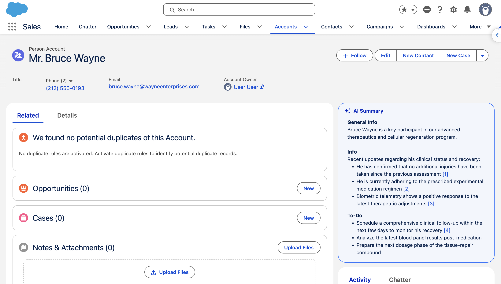

# Instant AI Summary

<a href="https://githubsfdeploy.herokuapp.com?owner=baslu93&repo=instant-ai-summary&ref=main">
  
</a>

Salesforce Lightning Web Component that displays an AI-generated record summary using a configurable prompt template. Runs automatically when visible without requiring user interaction.



Standard Salesforce AI Summary generates context when a user clicks a button. This component changes that interaction by running automatically as soon as it becomes visible.

While the Prompt Template runs in the background, the card takes up very little space, showing only a pulsing "AI Summary" title with a sparkle icon. Once the response is ready, the full summary renders directly inside the card, giving users immediate context the moment they open a record.

> [!WARNING]  
> This component consumes tokens when it becomes visible. Consider using it for orgs on an unmetered token tier.

## Setup

### 1. Assign the permission set

Assign the **Instant AI Summary User** permission set to every user who should see the summary card. This grants access to the required Apex classes and the `UseInstantAiSummary` custom permission.

> [!NOTE]
> Users also need the **EinsteinGPT Prompt Template User** permission set assigned separately.

### 2. Add the component to a record page

Open App Builder on any Record Page, drag **Instant AI Summary** onto the layout and select the Prompt Template of type **Record Summary** you want to use. Then set the component visibility filter to show only when the user has the **Use Instant AI Summary** custom permission. Save and activate the page.

### 3. Open a record

Navigate to any record of that object type and the summary will appear automatically on load.

## Components

| Component | Type | Description |
|---|---|---|
| `instantAiSummary` | LWC | Renders the AI-generated summary card on a record page. |
| `AiSummaryGenerateFromPrompt` | Apex | Calls the Einstein LLM API to run the prompt template against the current record. |
| `AiSummaryPromptsFilterByObject` | Apex | Dynamic picklist that filters available prompt templates by the page's object type, used in App Builder configuration. |
| `UseInstantAiSummary` | Custom Permission | Controls component visibility on Lightning pages; only users with this permission see the summary card. |
| `InstantAiSummaryUser` | Permission Set | Grants access to the required Apex classes and the `UseInstantAiSummary` custom permission. |


## Test

Run the setup script to create a scratch org, install the package, deploy test metadata, and seed a sample PersonAccount:

```bash
cd test
./scripts/setup.sh
```

## Requirements

- Salesforce org with Generative AI enabled
